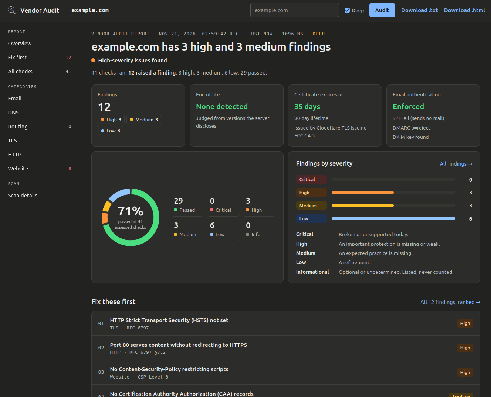

# Vendor Audit

**Try it at [vendoraudit.org](https://vendoraudit.org)** — type a domain, get a
report in a few seconds. Nothing to install.

Vendor Audit is a passive, fast check of how closely a domain follows
published best practices for DNS, email, TLS, HTTP and the website itself.
Each finding is rated Critical, High, Medium or Low and cites the RFC, W3C
specification, OWASP guidance or CA/Browser Forum requirement it is measured
against.

<a href="docs/report-page.png"></a>

*The report page on [vendoraudit.org](https://vendoraudit.org). Select the
image to see it full size.*

## On the web

[vendoraudit.org](https://vendoraudit.org) runs the same audit as the
command-line tool. The report is one page:

- a summary with the share of checks passed and the findings by severity
- the findings to fix first
- a table of every check, filtered by severity or category, and searchable
- a detail panel for each check: what was found, what the practice is, why
  it matters and how to fix it

A link to a report can point at one check. Every report can be downloaded
as a `.txt` file to share with the vendor, or as an `.html` file: a saved
copy of the report page that works offline, with its filters and check
details, and makes no network requests when opened.

The **Deep** checkbox adds DANE, the STARTTLS check on mail servers and a
read of the home page, for 3–5 extra seconds. SSL Labs grades (`--ssl`) and
bulk mode (`--file`) are command-line only: the SSL Labs Terms of Use don't
permit exposing their API on a public website, and bulk mode is meant for
generating a CSV of many domains.

To run your own copy of the website, see
[`deploy/INSTALL.md`](deploy/INSTALL.md). It's a separate, optional install:
the command-line tool from `pipx install` doesn't start a web server or
import the web packages. Only `pip install -e '.[web]'` (with the `[web]`
extra) pulls in FastAPI, uvicorn and the rest.

## On the command line

The command-line version audits one domain or a whole list, and writes the
same findings to the terminal, a plain-text report, a CSV row per domain or
JSON:

```bash
vendor-audit example.com --deep --report
vendor-audit --file domains.txt --outcsv results.csv
```

A default run makes about 85 checks in one to two seconds, and `--deep` adds
3–5 seconds. In bulk mode (`--file`) domains are audited 10 at a time, so
200 domains usually take under a minute. `--ssl` adds an SSL Labs grade;
it runs one domain at a time and adds 1–2 minutes per domain, because SSL
Labs runs the assessment on its own servers. See
[Installation](#installation) and [Usage](#usage).

## How it's meant to be used

Vendor Audit is a due-diligence tool. Run it on a vendor's domain before
purchasing a product or service to get a quick, evidence-based read on
how their domain configuration aligns with current best practices.
Findings aren't a deal-breaker on their own, but they're a useful
conversation starter and a data point alongside everything else you're
evaluating.

**Please share the report with the vendor.** The plain-text output
(`--report`) is designed to be readable by their technical team, and
every section cites the RFC, W3C spec, OWASP guidance, or CA/Browser Forum
baseline it's measured against — so the report reads as feedback, not as
an accusation. Most vendors appreciate a heads-up they can act on; the
report gives them one in a form they can take straight to the people who
can address it. When more than one prospect shares these reports with the
same vendor, they're more likely to prioritize the issues raised.

## Project scope

Vendor Audit is a lightweight maturity and best-practices audit. The
guiding constraint is that a default run should complete in about a second.
New checks that can't meet that bar belong behind `--deep`, and even
`--deep` checks should add no more than a couple of seconds total.

**Not in scope: anything offensive.** No port scanning, directory
brute-forcing, file or path guessing, login probing, or other behaviour
a WAF or firewall would treat as an attack. There are good tools for
that work; this isn't one of them. Vendor Audit reads what a domain
voluntarily publishes (DNS records, HTTP responses to a single GET, SMTP
EHLO banners, public APIs like SSL Labs and RIPEstat) and compares it
with published standards.

## Findings and severity

There is no score. Every check ends in one outcome, and each outcome has a
severity, set in `rubric.json`:

| Severity | Meaning |
| --- | --- |
| Critical | Broken or unsupported today: end-of-life OS or server software, no SPF or DMARC, no working HTTPS |
| High | An important protection is missing or weak: no HSTS, no CSP, TLS 1.0/1.1, an end-of-life library |
| Medium | An expected practice is missing: DNSSEC, CAA, IPv6, MTA-STS, automated certificates |
| Low | A refinement: SPF `~all`, version disclosure, minor headers |
| Info | Optional, or could not be determined (BIMI, DANE). Listed, never counted |

A report leads with the counts ("2 critical, 4 high, 11 medium, 10 low") and
a one-line verdict taken from the worst severity present. Nothing is added
up, and one cause is one finding: a missing HSTS header is a single High
finding, not three.

In the detail sections of the plain-text and terminal reports, each line
starts with a word that follows the same severities:

| Word | Meaning |
| --- | --- |
| CRITICAL, HIGH, MEDIUM, LOW, INFO | The line reports a finding of that severity |
| PASS | This part of a check is met (a check can pass in one part and fail in another) |
| NOTE | Observed, but not rated: accessibility signals, SSL Labs' own conditions |
| (none) | A plain fact, such as an address or a response time |

### Sorting a CSV of many domains

The CSV carries a few columns meant for sorting:

| Column | What it is | Sort |
| --- | --- | --- |
| `findings_sort_key` | The four counts side by side, three digits each: critical, high, medium, low. 2 critical, 4 high, 11 medium, 10 low is `2004011010` | Ascending = best first |
| `findings_issues` | Critical + high + medium + low | Ascending = fewest findings |
| `findings_critical_high` | Critical + high | Ascending |
| `findings_passed` | Checks met | Descending |
| `findings_passed_pct` | Passed as a share of passed + issues | Descending |

`findings_sort_key` is a sort key, not a score. Each severity has its own
block of digits, so no number of lower findings outweighs one higher
finding: fifty mediums still sort ahead of a single high. The gaps between
values mean nothing.

## What it checks

Vendor Audit groups checks into six categories. Every check maps to a published
standard (RFC, W3C spec, OWASP, or CA/Browser Forum baseline requirement) — no
made-up checks.

**Email** — SPF (one record, ending, lookup count, lookups that return
nothing, `ptr`, includes with no SPF record, `redirect=` resolution), DKIM
(common-selector probe, key strength), DMARC (one record, `p=` policy, `pct=`,
`sp=`, `rua=` reporting address, authorization of reports sent to other
domains), MX records (hygiene, hosts that don't resolve, reverse DNS), null MX
for domains that receive no mail, MTA-STS (record, policy fetch, policy
covering every MX host, `max_age`), TLS-RPT, BIMI, DANE TLSA on MX (`--deep`),
STARTTLS-MX (`--deep`).

**DNS** — DNSSEC chain validation (TLD signing, DNSKEY, AD flag) and signing
algorithm, CAA records, nameserver count, authoritative delegation, open
resolvers, SOA timers, nameservers on IPv6 and spread over networks, and
CNAMEs that point at names which no longer exist (subdomain takeover).

**Routing** — IPv6 reachability, IPv4 / IPv6 RPKI ROA coverage, IPv4 / IPv6
IRR/RIS presence (via RIPEstat), and RPKI for the nameservers' and mail
servers' addresses, plus mail servers on IPv6. ASN is reported for context only.

**TLS** — Cert validity, SAN coverage, lifetime (91 days or less reads as
automated issuance), renewal headroom (under 10% of the lifetime left is
overdue), name match, `www`-variant coverage, key size and signature, TLS 1.3
support, TLS 1.0 / 1.1 still accepted, forward secrecy (static RSA and NULL
ciphers refused), HSTS (presence, `includeSubDomains`, preload list, `max-age`
strength), and an optional SSL Labs grade with per-condition findings (`--ssl`).

**HTTP** — HTTP/2 / HTTP/3 (Alt-Svc) support, HTTPS DNS record (RFC 9460),
HTTP→HTTPS redirect presence, first-hop redirect hygiene, `www` / apex
unification. Response time is reported for context only.

**Website** — Server / X-Powered-By header disclosure, security headers (CSP
analyzed Google-Evaluator-style: `script-src`, `object-src`, `base-uri`,
`frame-ancestors`, and Report-Only-only policies;
X-Content-Type-Options, X-Frame-Options, Referrer-Policy, Permissions-Policy,
Cross-Origin-Opener-Policy, Cross-Origin-Resource-Policy, and the deprecated
X-XSS-Protection, Public-Key-Pins and Expect-CT), cookie attributes (Secure,
HttpOnly, SameSite, `__Host-` / `__Secure-` prefixes), security.txt (contact,
expiry, location, Canonical), default error page, CORS, server clock,
end-of-life detection for the operating system, server software and
client-side libraries, and under `--deep` a regex-light page parse for
Subresource Integrity, mixed content, page language, third-party origins, and
a basic accessibility subset.

The checks that open extra connections to the audited server are the TLS
1.0 / 1.1 and cipher probes: four handshakes, in parallel, each capped at 1.5
seconds. OpenSSL 3 can no longer offer RC4, 3DES or export ciphers, so those
are not tested.

## Installation

### Via pipx (recommended, all platforms)

```bash
pipx install git+https://github.com/chrono1313/Vendor-Audit.git
```

Pipx installs the tool into its own isolated virtualenv and puts a `vendor-audit`
command on your `PATH`, so dependencies don't collide with anything else on
the system. This is the smoothest path on modern Linux distros.

This installs **the CLI only**. It does not install a web server, does not
listen on any port, and does not start anything in the background. The
`vendor-audit` command is the entire program. (The web service that powers
[vendoraudit.org](https://vendoraudit.org) lives behind a separate, opt-in
`[web]` install path — see [`deploy/INSTALL.md`](deploy/INSTALL.md).)

```bash
# Install pipx itself if you don't already have it
sudo apt install pipx          # Debian / Ubuntu
sudo dnf install pipx          # Fedora
brew install pipx              # macOS
python -m pip install --user pipx   # Windows or fallback
pipx ensurepath                 # add pipx's bin dir to PATH; new shell required
```

To upgrade later:

```bash
pipx upgrade vendor-audit
```

To uninstall cleanly:

```bash
pipx uninstall vendor-audit
```

### From a clone (for development)

Python 3.12 or later. Use this method if you intend to modify the code.

```bash
git clone https://github.com/chrono1313/Vendor-Audit.git
cd Vendor-Audit
pip install -r requirements.txt
python -m vendor_audit --help
```

On Linux, if `pip install` is blocked by PEP 668 and you'd rather not use a
venv, the dependencies are also packaged by Debian/Ubuntu:

```bash
sudo apt install python3-dnspython python3-requests python3-httpx python3-tldextract
```

### Running the tests

The tests make no network requests and take a few seconds:

```bash
pip install -e '.[web,dev]'
python -m pytest
```

Each test file also runs on its own, without pytest:
`python3 tests/test_findings.py`. GitHub runs the full suite on every push
and pull request, on Python 3.12 through 3.14
(`.github/workflows/tests.yml`).

## Usage

### Single domain

```bash
vendor-audit example.com                    # terminal report only
vendor-audit example.com --outcsv out.csv   # also write CSV
vendor-audit example.com --report           # also write .txt report
vendor-audit example.com --json             # raw JSON for piping
```

### Bulk (one domain per line)

```bash
vendor-audit --file domains.txt --outcsv results.csv
vendor-audit --file domains.txt --outcsv results.csv --report reports/
```

In bulk mode, domains are audited in parallel (10 at a time by default,
adjustable via `--concurrency`). With `--report`, each successfully-audited
domain produces a separate `<domain>_<ISO>.txt` report in the given directory.

### Comparing two scans

Save a scan with `--json`, save another later, and `--compare` lists what
changed:

```bash
vendor-audit example.com --json > before.json
vendor-audit example.com --json > after.json      # later
vendor-audit --compare before.json after.json
```

```
  FIXED (1)
    HIGH      →  PASS       TLS      HTTP Strict Transport Security (HSTS) not set
  WORSE (1)
    PASS      →  MEDIUM     DNS      No Certification Authority Authorization (CAA) records
  STILL OPEN (2)
    MEDIUM                  Email    MTA-STS policy not published — ...
```

Findings are grouped as fixed, worse, better, new, no longer reported and
still open. Both scans are rated with the rules of the version doing the
comparison, so a difference is a change on the site, not a change in
Vendor Audit. No new audit runs.

### Deep mode

`--deep` enables three extra checks that are slower or have a higher false-
positive rate on bot-mitigated sites:

- DANE TLSA on each MX host (DNS queries that often time out on non-DNSSEC
  zones)
- STARTTLS-MX cert probe (port 25 egress; blocked on most cloud providers and
  residential ISPs)
- HTML page parse for Subresource Integrity, mixed content, third-party
  origins, and accessibility signals

Default-mode runs typically complete in 1–3 seconds per domain. `--deep` adds
3–5 seconds depending on MX count and server responsiveness.

### SSL Labs

`--ssl your@email.com` requests an SSL Labs API v4 assessment for the domain.
Requires a one-time email registration with Qualys (free):

```bash
vendor-audit --sslregistration --ssl your@email.com
```

The grade becomes a finding (F, T and M are Critical; D and E High; C
Medium; B and A- Low), and the report includes a Findings list explaining the conditions affecting the grade (vulnerable
protocols, named CVEs like Heartbleed/ROBOT/POODLE, missing forward secrecy,
certificate chain issues, etc.).

SSL Labs assessments take 60–120 seconds per domain and are run sequentially
to respect the API rate limit; cached reports up to 24 hours old are accepted
by default (override with `--ssl-no-cache`).

> **Running from a clone instead of a pipx install?** Replace `vendor-audit`
> in any example above with `python -m vendor_audit`. The flags are identical.

## Output

Three output formats, used independently or together:

- **Terminal report** (default) — the plain-text report's detail lines in
  colour, without its explanation paragraphs, followed by a summary.
- **CSV** (`--outcsv`) — one row per domain with every measured field. The CSV
  schema is versioned (`meta_schema_version`); upgrades that change the schema
  cause Vendor Audit to refuse to append to the old file.
- **Plain-text report** (`--report`) — 100-column UTF-8, severity-grouped
  findings, suitable for sharing with the vendor's technical team.
- **JSON** (`--json`) — the raw result of every check, plus `findings`
  (each with its severity, category and sentence) and a `summary` with the
  counts by severity. The banner goes to stderr, so `--json > scan.json`
  saves pure JSON, ready for `--compare`.

## End-of-life data

Three data files carry end-of-life **dates**, and every audit compares them
with today's date. A release is flagged from the day its support ends; nobody
has to remember to bump a version floor.

| File | Covers | Read from |
| --- | --- | --- |
| `os_eol.json` | CentOS, CentOS Stream, RHEL, AlmaLinux, Rocky, Oracle Linux, Scientific Linux, Ubuntu, Debian / Raspbian, FreeBSD, IIS → Windows Server | `Server` header, PHP package suffix, default error page |
| `tech_eol.json` | Apache httpd, nginx, OpenSSL, PHP, Tomcat, Jetty, Python, Ruby, Perl, ASP.NET, ASP.NET MVC, SharePoint Server | `Server`, `X-Powered-By`, `X-AspNet*`, `MicrosoftSharePointTeamServices`, default error page |
| `library_eol.json` | ~50 of the ~185 client-side libraries and CMSes the detector recognises | page HTML |

Most dates come from [endoflife.date](https://endoflife.date). Nothing is
fetched while auditing; the files are refreshed by a maintainer script:

```bash
python3 tools/update_eol_data.py --check   # show what would change
python3 tools/update_eol_data.py           # rewrite the three files
```

Releases already in the files expire on schedule without a refresh. The
refresh is what teaches the audit about releases published since, so run it
every few months (`tests/test_eol_data.py` fails once the data is a year old).
Entries without an `endoflife` block are curated by hand and cite a `source`:
projects with no published policy, and projects whose own maintainers have
declared them discontinued (Moment.js, CryptoJS, oidc-client-js and others).

Two rules keep the findings defensible:

- **Free support is the yardstick.** Ubuntu standard support, Debian LTS,
  RHEL maintenance support, Windows extended support. Where a paid extension
  is still on sale the finding says so, because the audit cannot see from
  outside whether a server has one.
- **Distro packages are not judged by upstream's date.** Debian, Ubuntu and
  RHEL patch the nginx / OpenSSL / Python / PHP they ship for years after
  upstream stops. Those products are flagged only when the version is old
  enough that every distribution that shipped it is itself unsupported, or
  on a Windows build, where no distribution is involved. A distro named without a version
  (`Apache/2.4.29 (Ubuntu)`) is resolved to a release from the exact package
  version and judged as that release.

## Limitations

- **Passive only.** See "Project scope" above. Safe to run against any
  third party without prior coordination.
- **External view only.** A vendor with strong externally-visible posture can
  still have weak internal controls; Vendor Audit makes no claim about what
  it can't see.
- **Single point in time.** The report reflects the moment of the scan.
  Re-run periodically and use `--compare` to see what changed.
- **Bot-mitigated sites.** Cloudflare / Akamai / AWS WAF challenge pages
  produce unreliable page-level findings, which is why page parsing is
  gated behind `--deep` rather than running by default. When Cloudflare
  answers with a challenge or block page, the report says so at the top,
  and failing Website and HSTS checks are shown as Informational, since
  they describe Cloudflare's page rather than the site. These reverse
  proxies may obscure other findings like outdated server OSes, but the
  report should still be accurate as to externally-visible exposure
  and configuration.

## Contributing

Contributions welcome. New checks should map to a published standard
(RFC, W3C spec, OWASP, or CA/Browser Forum baseline requirement) — the audit's
value comes from being able to point at a citation for everything it flags.
Open an issue or pull request on GitHub.

## License

GNU General Public License v3.0 or later. See `LICENSE` for the full text.

This is free software: you are welcome to redistribute and modify it under
the terms of the GPL. There is **NO WARRANTY**, to the extent permitted by
applicable law.
